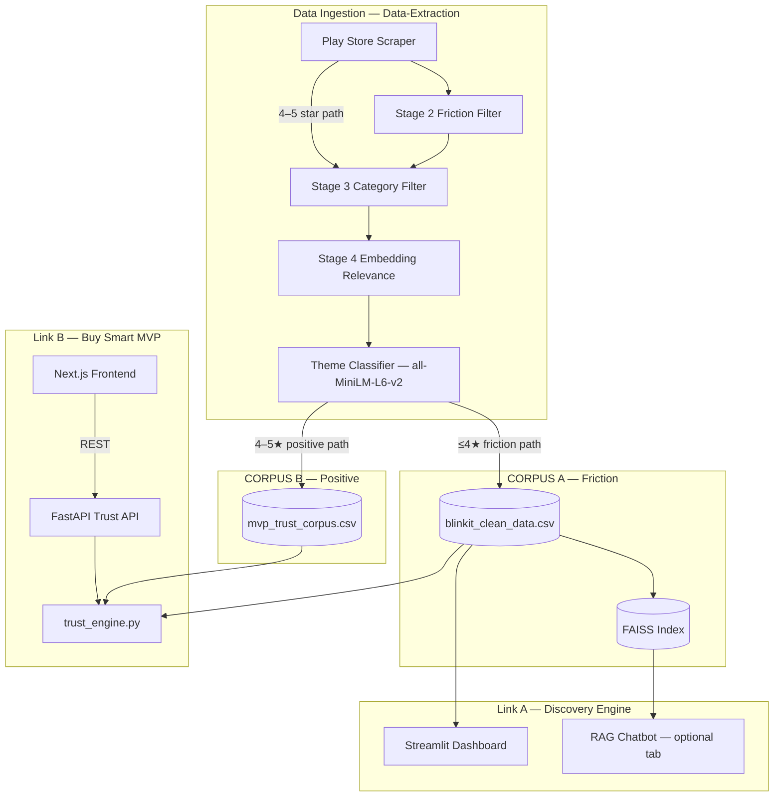
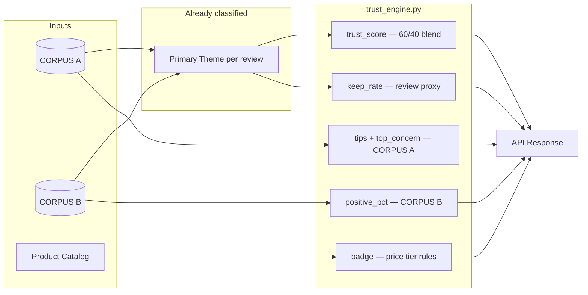
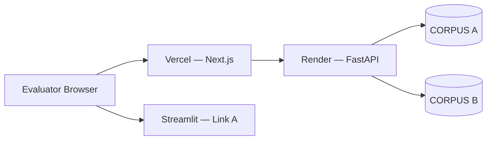

# Buy Smart — System Architecture

> Technical architecture for the Blinkit Growth graduation project.  
> Product context: [`context.md`](./context.md) · Problem framing: [`problemstatement.txt`](./problemstatement.txt)

**Deadline:** 4 Aug 2026  
**Submission:** Link A (Discovery Engine) + Link B (Buy Smart MVP) + 10-slide deck

---

## 1. Overview

Two independently deployed systems share research and AI pipeline code but **must not share the same review CSV for Discovery analysis**.

| Deploy | Name | Purpose | Stack | Repo path |
|--------|------|---------|-------|-----------|
| **Link A** | AI Discovery Engine | Research: friction themes, insights, PM story | Streamlit, Python | `../Data-Extraction/` |
| **Link B** | Buy Smart MVP | Product: in-app trust layer prototype | Next.js + FastAPI | `AI-Native-MVP/` |



---

## 2. Repository Layout

```
Graduation Project/
├── Data-Extraction/              # Link A + shared AI pipeline
│   ├── app.py                    # Streamlit Discovery Engine
│   ├── main.py                   # Scrape + classify pipeline
│   ├── engine/
│   │   ├── themes.py             # Embedding theme classification
│   │   ├── trust_engine.py       # Trust scores, catalog, keep rate
│   │   └── …                     # FAISS, filters, etc.
│   ├── scrapers/playstore.py     # scrape_playstore_positive()
│   └── Output/
│       └── blinkit_clean_data.csv    # CORPUS A — do not contaminate
│
└── AI-Native-MVP/                # Link B
    ├── docs/
    │   ├── problemstatement.txt
    │   ├── context.md
    │   └── architecture.md       # this file
    ├── data/
    │   └── mvp_trust_corpus.csv  # CORPUS B
    ├── backend/                  # FastAPI (planned)
    │   ├── main.py
    │   ├── routes/trust.py
    │   └── services/trust_service.py
    └── frontend/                 # Next.js (planned)
        ├── app/
        └── components/
            ├── CategoryStrip.tsx
            ├── ProductPDP.tsx
            └── TrustSheet.tsx
```

---

## 3. Link A — AI Discovery Engine

### Role

Find and explain **why** users don't repeat non-grocery purchases. Powers the research narrative (*trust, not discovery*).

### Inputs

- Play Store + Reddit reviews (existing pipeline)
- **CORPUS A only:** ~1,505 reviews, friction-biased (Stage 2 keeps complaints)

### AI components

| Component | Technology | Output |
|-----------|------------|--------|
| Theme classification | `all-MiniLM-L6-v2` + anchor sentences | `Primary Theme` per review |
| Semantic search | FAISS (384-dim embeddings) | Evidence retrieval for chatbot |
| Theme analysis | Groq Llama 3.3 70B (dashboard) | Structured insight summaries |

### Outputs

- Streamlit dashboard: theme breakdown, category friction, quotes
- FAISS index for semantic search (internal / demo chatbot tab)
- **Does not** power consumer-facing Buy Smart scores directly

### Rule

**Never add CORPUS B positive reviews into `blinkit_clean_data.csv`.**

---

## 4. Link B — Buy Smart MVP

### Role

Simulate Blinkit's in-app **trust layer** for Cautious Dabblers. Pre-purchase signals only — not chatbot, not price comparison.

### User surfaces → backend mapping

| UI surface | Frontend component | API | Fields shown |
|------------|-------------------|-----|--------------|
| **Category page** | `CategoryStrip` | `GET /api/trust/category/{slug}` | `trust_score`, `guidance`, `review_count` |
| **Product page (PDP)** | `ProductPDP` | `GET /api/trust/product/{id}` | `keep_rate`, `replacement_days`, `warranty`, `badge` |
| **See how sheet** | `TrustSheet` | same product endpoint | `trust_score`, `keep_rate`, `positive_pct`, `mention_count`, `tips`, `top_concern`, `evidence_label` |

### PDP vs trust sheet split

```
PDP (minimal)                    Trust sheet (full)
─────────────────────────────    ─────────────────────────────
keep_rate                        trust_score
replacement | warranty           positive_mentions_pct
price-tier badge                 mention_count + evidence_label
See how →                        tips[], top_concern
                                 footnote (review proxy / prod data)
```

---

## 5. Trust API (FastAPI)

### Endpoints

#### `GET /api/trust/category/{slug}`

**Slug examples:** `electronics`, `personal_care_beauty`

```json
{
  "category": "electronics",
  "label": "Electronics",
  "trust_score": 62,
  "review_count": 412,
  "guidance": "Start repeat habits with known brands under ₹2k",
  "top_concern": "Warranty & Return Anxiety"
}
```

#### `GET /api/trust/product/{id}`

**ID example:** `boat-airdopes-141`

```json
{
  "product_id": "boat-airdopes-141",
  "name": "boAt Airdopes 141",
  "brand": "boat",
  "price": 1299,
  "category": "electronics",
  "replacement_days": 7,
  "warranty": "1 year manufacturer warranty",
  "keep_rate": 81,
  "trust_score": 71,
  "positive_pct": 62,
  "mention_count": 47,
  "badge": "Safe to repeat · See how →",
  "tips": [
    "Known brand — lower counterfeit risk",
    "Record unboxing video before opening"
  ],
  "top_concern": "Warranty & Return Anxiety",
  "evidence_label": "Based on 47 public review mentions"
}
```

#### `GET /api/health`

Liveness check for Render deploy.

### Badge logic (price-tier)

```python
if price <= 2000 and known_brand and trust_score >= threshold:
    badge = "Safe to repeat · See how →"
elif price <= 5000:
    badge = "Verify warranty · See how →"
else:
    badge = "Check return policy · See how →"
```

Never return discouraging copy (`"Don't buy"`, `"Skip"`, `"Use Amazon"`).

---

## 6. Trust Engine — Scoring Pipeline

Implemented in `../Data-Extraction/engine/trust_engine.py` (copied or imported into `backend/`).



### Signal sources (locked)

| Signal | Formula / source | UI surface |
|--------|------------------|------------|
| **Trust score** | `baseline + (0.6 × favorable_B) − (0.4 × risk_A)` | See how |
| **Keep rate** | `compute_keep_rate()` — favorable themes / brand mentions, clamped 35–85% | PDP + See how |
| **Positive mentions %** | Positive theme ratio on CORPUS B subset | See how |
| **Tips** | Top friction themes for brand/category from CORPUS A | See how |
| **Top concern** | Most frequent negative theme in CORPUS A for category | See how + category strip |
| **Badge** | Price tier + known brand rules | PDP |

### Keep rate proxy (Option A)

1. Match reviews → product by **brand + category** (text search on `Raw Content`)
2. Count favorable vs negative **embedding-classified** themes
3. `keep_rate = favorable / total` (clamp 35–85%)

| Mentions | Fallback |
|----------|----------|
| ≥ 3 | Brand-level proxy |
| 1–2 | Category-level estimate |
| 0 | Category favorable rate from CORPUS B |

**MVP:** review proxy. **Production:** swap data source to Blinkit repurchase metric — same API field, same UI.

### Product catalog

Simulated listings in `PRODUCT_CATALOG` dict (not live Blinkit API). MVP-only.

---

## 7. Dual Corpus Strategy

| | CORPUS A | CORPUS B |
|---|----------|----------|
| **File** | `Data-Extraction/Output/blinkit_clean_data.csv` | `AI-Native-MVP/data/mvp_trust_corpus.csv` |
| **Star bias** | ≤4★ friction filter | 4–5★ scrape |
| **Purpose** | Discovery, risks, tips | Favorable signals, positive % |
| **Used by** | Link A + trust engine (risk leg) | Link B trust engine (favorable leg) |
| **Stage 2 filter** | Yes — keeps complaints | No |

### Build CORPUS B

```bash
cd ../Data-Extraction
python main.py --positive --max-positive 200 --classify offline
# Export classified output → AI-Native-MVP/data/mvp_trust_corpus.csv
```

Pipeline steps for B:

1. `scrape_playstore_positive()` in `scrapers/playstore.py`
2. Stage 3 — non-grocery category filter
3. Stage 4 — embedding relevance filter
4. Theme classification via `themes.py` (embedding method)
5. **Skip** Stage 2 low-star friction filter

---

## 8. AI-Native Layer

What makes Link B more than a static badge:

| Capability | Implementation | User-visible result |
|------------|----------------|---------------------|
| Theme classification | `themes.py` — MiniLM embeddings vs anchor sentences | Trust score, keep rate, tips |
| Semantic relevance | Stage 4 embedding filter on scrape | Non-grocery signal quality |
| Brand matching | Regex + category scope on classified corpus | Per-product keep rate |
| Evidence retrieval (optional) | FAISS on combined index | 1–2 review snippets in See how |
| Dynamic tips | Theme frequency per product subset | Contextual checklist in sheet |

**Explicitly not in MVP:** chatbot input, LLM on every request (optional offline summaries only), Amazon redirects, hardcoded scores.

---

## 9. Frontend Architecture (Next.js)

### Pages

| Route | Screen |
|-------|--------|
| `/` | Home — category grid (Blinkit-style shell) |
| `/category/[slug]` | Category listing + Buy Smart strip |
| `/product/[id]` | PDP + trust row + See how trigger |

### Key components

```
frontend/components/
├── BuySmartStrip.tsx      # Category trust score + guidance
├── TrustRow.tsx           # replacement | warranty | keep_rate
├── PriceTierBadge.tsx     # Safe to repeat / Verify warranty / Check return policy
├── TrustSheet.tsx         # Bottom modal — full breakdown
└── BlinkitShell.tsx       # Nav, layout, mobile-first frame
```

### Data fetching

- Server or client fetch to FastAPI base URL (`NEXT_PUBLIC_API_URL`)
- No secrets in frontend — public read-only trust endpoints
- Loading skeletons on PDP trust row

---

## 10. Deployment

| Service | Platform | Branch / root | Env vars |
|---------|----------|-------------|----------|
| Discovery Engine | Streamlit Cloud / existing host | `Data-Extraction/` | Groq key (if live LLM) |
| Buy Smart API | Render | `AI-Native-MVP/backend/` | `CORPUS_A_PATH`, `CORPUS_B_PATH` |
| Buy Smart UI | Vercel | `AI-Native-MVP/frontend/` | `NEXT_PUBLIC_API_URL` |



### CORS

FastAPI allows Vercel production + preview origins.

---

## 11. Production Evolution (Post-MVP)

| MVP | Production Blinkit |
|-----|-------------------|
| Simulated product catalog | Live catalog API |
| Review proxy keep rate | Internal repurchase / retention data |
| Public Play Store corpora | Blinkit reviews + order signals |
| Static tips from themes | Tips + ops policies (return SLA, CS) |
| Separate deploy links | Native in-app module |

API contract (`keep_rate`, `trust_score`, `badge`, `tips`) stays stable — data sources swap behind the service layer.

---

## 12. Build Phases

| Phase | Work | Output |
|-------|------|--------|
| **0** | Docs + repo scaffold | `docs/`, empty `backend/`, `frontend/` |
| **1** | Scrape + export CORPUS B | `data/mvp_trust_corpus.csv` |
| **2** | Trust engine updates | 60/40 score, keep proxy, badges |
| **3** | FastAPI + trust_engine port | Working `/api/trust/*` locally |
| **4** | **Lovable / Stitch UI generation** | Exported Next.js prototype |
| **5** | Import + wire API + polish | Category + PDP + TrustSheet live |
| **6** | Deploy Link A + Link B | URLs for deck |
| **7** | Deck + screenshots | Submission |

See [`implementation.md`](./implementation.md) for Lovable prompt and export steps.

---

## 13. Data Honesty Checklist (Deck)

- [ ] Two corpora named and separated
- [ ] Trust score = 60% B + 40% A theme blend
- [ ] Keep rate = review proxy in MVP; Blinkit data in prod
- [ ] Catalog simulated; not official Blinkit CSAT
- [ ] Discovery Engine friction bias explained

---

## Related Documents

| File | Role |
|------|------|
| [`context.md`](./context.md) | Product context, UX spec, copy guardrails |
| [`problemstatement.txt`](./problemstatement.txt) | Submission problem definition |
| [`implementation.md`](./implementation.md) | Step-by-step build guide |
| [`edge-cases.md`](./edge-cases.md) | Failure modes, boundary tests, QA script |
| `../Data-Extraction/engine/trust_engine.py` | Scoring implementation |
| `../Data-Extraction/engine/themes.py` | Embedding theme classifier |
